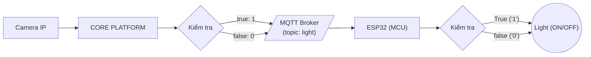

# Mô hình Gửi–Nhận Tin nhắn qua MQTT với Node-RED

Bài thực hành xây dựng chương trình minh họa giao tiếp tin nhắn theo mô hình **Publish/Subscribe** của giao thức **MQTT** bằng **Node-RED** (`mqtt out`, `mqtt in`, `function`, `inject`, `debug`), bao gồm:
1. **Mô phỏng bài toán điều khiển đèn từ Camera IP:** `Camera IP` $\rightarrow$ `CORE PLATFORM` $\rightarrow$ `MQTT (topic: light)` $\rightarrow$ `ESP32 (MCU)` $\rightarrow$ `Light`.
2. **Mô hình giao tiếp hai chiều (`Bên A` $\leftrightarrow$ `Bên B`) và 5 bài kiểm thử lý thuyết** (Topic, 1–N, Wildcard, Retained Message, QoS).

---

## 1. Nguyên lý giao tiếp MQTT

Trong MQTT, bên gửi (**Publisher**) không gửi trực tiếp đến địa chỉ của bên nhận (**Subscriber**), mà xuất bản thông điệp vào một chủ đề (**Topic**) trên **Broker**. Broker tiếp nhận và phân phối thông điệp tới các bên đã đăng ký (subscribe) chủ đề phù hợp.

* **Broker:** Trạm trung gian tiếp nhận và phân phối tin nhắn.
* **Topic:** Chủ đề dùng để định tuyến tin nhắn (ví dụ: `light`, `demo/a_to_b`, `demo/b_to_a`).
* **Payload:** Nội dung tin nhắn (ví dụ: `"1"`, `"0"`, `"Xin chào B"`, hoặc chuỗi JSON).

---

## 2. Đối chiếu giữa Code giao tiếp và Node-RED

Ở mức lý thuyết, chương trình MQTT gồm các bước:

```text
Khởi tạo MQTT client
Cấu hình địa chỉ broker và thông tin kết nối

Khi kết nối thành công:
    Đăng ký (subscribe) topic cần nhận

Khi cần gửi:
    Chọn topic
    Tạo nội dung tin nhắn (payload)
    Publish tin nhắn lên broker

Khi nhận tin nhắn:
    Đọc topic
    Đọc payload
    Hiển thị hoặc xử lý nội dung
```

Khi thực hiện trên **Node-RED**, các thành phần trong code tương ứng với:

| Logic trong chương trình | Cách thể hiện trong Node-RED |
| :--- | :--- |
| Cấu hình và kết nối Broker | Cấu hình **Server** của node MQTT |
| Tạo sự kiện gửi (Trigger) | Node `inject` |
| Chuẩn bị `topic`, `payload` và xử lý rẽ nhánh | Node `function` |
| Publish thông điệp lên Broker | Node `mqtt out` |
| Subscribe và tiếp nhận thông điệp | Node `mqtt in` |
| Quan sát kết quả | Node `debug` |

---

## 3. Áp dụng vào bài toán: `Camera IP` $\rightarrow$ `CORE PLATFORM` $\rightarrow$ `ESP32 (Light)`

### 3.1. Sơ đồ luồng xử lý



### 3.2. Cách dựng và viết Code trong Node-RED (Tab 1)

Không cần phần cứng Camera hay mạch ESP32 thật, toàn bộ luồng gửi – nhận – kiểm tra điều kiện được mô phỏng trực tiếp trên Node-RED:

```text
NHÁNH GỬI (CORE PLATFORM):
[inject: Camera IP = true/false] -> [function: CORE PLATFORM] -> [mqtt out: topic "light"]

NHÁNH NHẬN (ESP32 MCU):
[mqtt in: topic "light"] -> [function: ESP32 (MCU)] -> [debug: Light]
```

* **Code trong node `function: CORE PLATFORM` (Bên gửi):**
  ```javascript
  // 1. Nhận kết quả từ Camera IP (true hoặc false)
  const cameraDetected = msg.payload;

  // 2. Chọn topic theo đúng sơ đồ: topic: light
  msg.topic = "light";

  // 3. Khối hình thoi rẽ nhánh phía CORE PLATFORM
  if (cameraDetected === true) {
      msg.payload = "1"; // Nhánh true:1
  } else {
      msg.payload = "0"; // Nhánh false:0
  }

  return msg;
  ```

* **Code trong node `function: ESP32 (MCU)` (Bên nhận & xử lý tin nhắn):**
  ```javascript
  // 1. Đọc payload nhận được từ topic: light
  const payload = String(msg.payload).trim();

  // 2. Khối hình thoi kiểm tra điều kiện phía ESP32 (MCU)
  if (payload === "1") {
      // Nhánh True -> Bật đèn Light
      msg.condition = "True";
      msg.lightStatus = "LIGHT ON (Bật đèn)";
      node.status({ fill: "green", shape: "dot", text: "True -> Light: ON" });
  } else {
      // Nhánh false -> Tắt đèn Light
      msg.condition = "false";
      msg.lightStatus = "LIGHT OFF (Tắt đèn)";
      node.status({ fill: "grey", shape: "ring", text: "false -> Light: OFF" });
  }

  return msg;
  ```

---

## 4. Mô hình Test hai chiều (`Bên A` $\leftrightarrow$ `Bên B`) và Truyền JSON (Tab 2)

```text
BÊN A
[inject: A gửi tin] -> [function: tạo tin A] -> [mqtt out: demo/a_to_b]
[mqtt in: demo/b_to_a] -> [debug: A nhận]

BÊN B
[mqtt in: demo/a_to_b] -> [debug: B nhận]
[inject: B gửi tin] -> [function: tạo tin B] -> [mqtt out: demo/b_to_a]
```

* **Code tạo tin nhắn của A (`demo/a_to_b`):**
  ```javascript
  msg.topic = "demo/a_to_b";
  msg.payload = "Xin chào B";
  return msg;
  ```
* **Code tạo tin nhắn của B (`demo/b_to_a`):**
  ```javascript
  msg.topic = "demo/b_to_a";
  msg.payload = "B đã nhận được tin nhắn";
  return msg;
  ```
* **Phân biệt đối tượng `msg` trong Flow và gói tin MQTT (Gửi nhiều trường bằng JSON):**
  Node `mqtt out` chỉ lấy `msg.topic` làm chủ đề và `msg.payload` làm nội dung gửi qua MQTT, không tự động truyền toàn bộ các thuộc tính khác của biến `msg`. Khi cần truyền nhiều trường dữ liệu (ví dụ cả trạng thái Camera, tên thiết bị, nội dung), ta đóng gói thành chuỗi JSON:
  ```javascript
  msg.topic = "demo/a_to_b";

  msg.payload = JSON.stringify({
      sender: "A",
      text: "Xin chào B"
  });

  return msg;
  ```

---

## 5. Các tính năng kiểm thử và Ý nghĩa lý thuyết

| Bài Test | Cách thực hiện trên Node-RED | Kết quả & Ý nghĩa lý thuyết |
| :--- | :--- | :--- |
| **Test 1: Topic quyết định bên nhận** | Giữ bên gửi publish vào `demo/a_to_b` (hoặc `light`), đổi topic của `mqtt in` bên nhận thành `demo/other`. | Bên nhận không nhận được tin vì topic không khớp. Broker chỉ định tuyến thông điệp dựa trên sự trùng khớp của topic. |
| **Test 2: Một bên gửi, nhiều bên nhận** | Tạo thêm một node `mqtt in` thứ hai cùng đăng ký một topic (`demo/a_to_b` hoặc `light`). | Khi bên gửi publish 1 lần, cả hai nhánh nhận đều nhận được cùng nội dung. Chứng minh khả năng phân phối một–nhiều của MQTT. |
| **Test 3: Đăng ký nhiều topic bằng Wildcard** | Đổi topic của một node `mqtt in` thành `demo/#`. | Nhận được tất cả thông điệp thuộc nhánh `demo`, gồm cả `demo/a_to_b` và `demo/b_to_a` (`+` khớp 1 cấp, `#` khớp nhiều cấp). |
| **Test 4: Retained Message** | Bật **Retain** (`msg.retain = true`) trên `mqtt out`, gửi `"Trạng thái mới nhất: sẵn sàng"`, sau đó cho một subscriber mới đăng ký vào topic đó. | Subscriber mới nhận ngay thông điệp retained gần nhất mà không cần bên gửi gửi lại. |
| **Test 5: Quality of Service (QoS)** | Cấu hình thử nghiệm 3 mức QoS (`0`, `1`, `2`) trên các node MQTT. | **QoS 0:** Có thể mất tin, không xác nhận.<br>**QoS 1:** Chuyển giao ít nhất một lần, có thể trùng.<br>**QoS 2:** Chuyển giao đúng một lần trên chặng MQTT. |

---

## 6. Hình ảnh minh họa

*(Đặt ảnh sơ đồ và ảnh chụp màn hình Node-RED vào thư mục `images/`)*

* **Sơ đồ hệ thống điều khiển đèn qua MQTT (`topic: light`):**
  ``
* **Kết quả chạy mô hình Camera IP $\rightarrow$ CORE PLATFORM $\rightarrow$ ESP32 (Light) trên Node-RED:**
  ``
* **Kết quả giao tiếp hai chiều và các bài test lý thuyết:**
  ``
