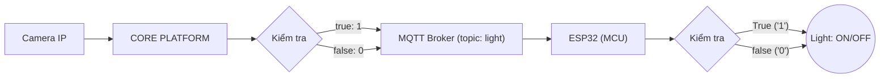
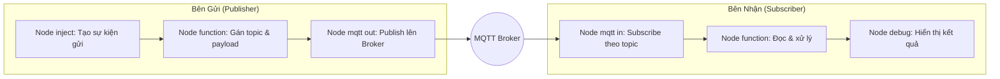

# Mô phỏng Giao tiếp MQTT trên Node-RED: Từ Lý thuyết đến Điều khiển Thiết bị (Camera IP $\rightarrow$ ESP32)

Kho lưu trữ này trình bày cách xây dựng và kiểm nghiệm mô hình truyền nhận tin nhắn theo kiến trúc **Publish/Subscribe** của giao thức **MQTT** trên nền tảng **Node-RED**. Thay vì phụ thuộc vào phần cứng vật lý hay cơ sở dữ liệu bên ngoài, dự án tập trung vào **bản chất luồng dữ liệu, cách viết code xử lý bản tin (`msg.topic`, `msg.payload`) và cơ chế hoạt động của MQTT Broker**.

---

## Tổng quan Bài toán & Sơ đồ Kiến trúc

Hệ thống mô phỏng quy trình tự động hóa giữa khối xử lý trung tâm (**CORE PLATFORM**) và vi điều khiển (**ESP32 MCU**) thông qua giao thức **MQTT** với chủ đề định tuyến là `topic: light`:



### Giải thích luồng hoạt động theo sơ đồ:
1. **Khối phát hiện (`Camera IP` $\rightarrow$ `CORE PLATFORM`):**
   * Nhận trạng thái phát hiện từ Camera (`true` hoặc `false`).
   * Thực hiện kiểm tra điều kiện (khối rẽ nhánh):
     * Nếu `true` $\rightarrow$ Đóng gói payload giá trị `"1"`.
     * Nếu `false` $\rightarrow$ Đóng gói payload giá trị `"0"`.
   * Xuất bản (Publish) gói tin lên **MQTT Broker** dưới chủ đề `topic: light`.
2. **Khối chấp hành (`MQTT Broker` $\rightarrow$ `ESP32 (MCU)` $\rightarrow$ `Light`):**
   * `ESP32 (MCU)` đăng ký theo dõi (Subscribe) chủ đề `topic: light` trên Broker.
   * Khi nhận được gói tin mới, `ESP32` đọc nội dung payload và kiểm tra:
     * Nhánh `True` (payload = `"1"`) $\rightarrow$ Kích hoạt bật đèn (**Light ON**).
     * Nhánh `false` (payload = `"0"`) $\rightarrow$ Ngắt đèn (**Light OFF**).

---

## Bản chất Giao tiếp MQTT & Cách thể hiện trong Node-RED

### 1. Ba thành phần cốt lõi của MQTT
Khác với mô hình truyền thông trực tiếp (Point-to-Point), MQTT tách rời bên gửi và bên nhận thông qua 3 yếu tố:
* **Broker (Trạm trung chuyển):** Tiếp nhận gói tin từ bên gửi, kiểm tra danh sách đăng ký và chuyển tiếp gói tin đến đúng bên nhận.
* **Topic (Chủ đề định tuyến):** Chuỗi ký tự phân cấp (như `light`, `demo/a_to_b`) đóng vai trò là "địa chỉ hộp thư" để Broker phân loại tin nhắn.
* **Payload (Nội dung gói tin):** Dữ liệu thực tế được truyền đi (chuỗi văn bản, số `"1"`/`"0"`, hoặc chuỗi JSON).

### 2. Từ cấu trúc Code truyền thống sang các Node của Node-RED
Khi lập trình MQTT bằng code thuần, chương trình luôn phải đi qua 4 giai đoạn: **Kết nối Broker $\rightarrow$ Đăng ký Topic $\rightarrow$ Tạo & Gửi tin $\rightarrow$ Nhận & Xử lý tin**. Trong Node-RED, từng giai đoạn này được tách thành các khối chức năng riêng biệt:



* **Cấu hình kết nối Broker:** Được thiết lập trong mục `Server` của hai node `mqtt in` và `mqtt out` (trỏ tới địa chỉ và cổng của Broker, mặc định là cổng `1883`).
* **Node `inject`:** Đóng vai trò tạo tín hiệu kích hoạt (giả lập sự kiện từ Camera IP hoặc thao tác nhấn gửi của người dùng).
* **Node `function`:** Nơi viết code JavaScript để đóng gói dữ liệu trước khi gửi hoặc giải mã/rẽ nhánh dữ liệu sau khi nhận.
* **Node `mqtt out` & `mqtt in`:** Đảm nhận việc đóng gói giao thức mạng để Publish và Subscribe với Broker.
* **Node `debug`:** Xuất toàn bộ đối tượng thông điệp (`msg`) ra màn hình giám sát để kiểm tra kết quả.

---

## Chi tiết Code xử lý trong các Node `function`

File cấu hình [flows.json](flows.json) của dự án gồm **2 Tab thực hành** với các đoạn code xử lý trọng tâm sau:

### Tab 1: Mô phỏng bài toán `Camera IP` $\rightarrow$ `CORE PLATFORM` $\rightarrow$ `ESP32 (Light)`

* **Tại node `CORE PLATFORM` (Chuẩn bị bản tin điều khiển):**
  ```javascript
  // Nhận tín hiệu từ Camera IP (true hoặc false)
  const cameraDetected = msg.payload;

  // Thiết lập chủ đề gửi theo sơ đồ thiết kế
  msg.topic = "light";

  // Rẽ nhánh điều kiện trước khi đưa vào node mqtt out
  if (cameraDetected === true) {
      msg.payload = "1"; // Nhánh true:1
  } else {
      msg.payload = "0"; // Nhánh false:0
  }

  return msg;
  ```
  *(Lưu ý: Trên node `mqtt out`, trường `Topic` được để trống để node tự động lấy giá trị `msg.topic` từ đoạn code trên).*

* **Tại node `ESP32 (MCU)` (Đọc bản tin và điều khiển đèn `Light`):**
  ```javascript
  // Đọc dữ liệu payload nhận về từ topic "light"
  const payload = String(msg.payload).trim();

  // Kiểm tra điều kiện để cập nhật trạng thái đèn
  if (payload === "1") {
      msg.condition = "True";
      msg.lightStatus = "LIGHT ON (Bật đèn)";
      node.status({ fill: "green", shape: "dot", text: "True -> Light: ON" });
  } else {
      msg.condition = "false";
      msg.lightStatus = "LIGHT OFF (Tắt đèn)";
      node.status({ fill: "grey", shape: "ring", text: "false -> Light: OFF" });
  }

  return msg;
  ```

---

### Tab 2: Giao tiếp hai chiều (`Bên A` $\leftrightarrow$ `Bên B`) & Đóng gói JSON

Để chứng minh mỗi MQTT Client đều có thể vừa gửi vừa nhận độc lập, Tab 2 xây dựng hai nhánh giao tiếp qua hai chủ đề quy ước:
* Chiều **A gửi sang B** (`topic: demo/a_to_b`):
  ```javascript
  msg.topic = "demo/a_to_b";
  msg.payload = "Xin chào B";
  return msg;
  ```
* Chiều **B phản hồi lại A** (`topic: demo/b_to_a`):
  ```javascript
  msg.topic = "demo/b_to_a";
  msg.payload = "B đã nhận được tin nhắn";
  return msg;
  ```

#### Lưu ý quan trọng: Sự khác biệt giữa biến `msg` của Node-RED và gói tin MQTT
Trong Node-RED, `msg` là một đối tượng JavaScript di chuyển qua dây nối giữa các node. Tuy nhiên, khi đi qua node `mqtt out`, **chỉ có `msg.payload` được gửi đi làm nội dung bản tin MQTT** (các thuộc tính tự thêm vào `msg` sẽ không tự động truyền qua mạng).

Do đó, khi cần truyền một cấu trúc gồm nhiều trường dữ liệu (ví dụ: người gửi, nội dung, trạng thái), bên gửi cần chuyển đổi đối tượng sang chuỗi **JSON**:
```javascript
msg.topic = "demo/a_to_b";

msg.payload = JSON.stringify({
    sender: "A",
    text: "Xin chào B"
});

return msg;
```
Ở phía nhận, node `mqtt in` (đặt ở chế độ `auto-detect` hoặc `parsed JSON object`) sẽ tự động chuyển chuỗi JSON này thành đối tượng JavaScript để truy xuất từng thuộc tính `msg.payload.sender` và `msg.payload.text`.

---

## Các Kịch bản Kiểm chứng Lý thuyết trên Node-RED

Sử dụng trực tiếp các node trên workspace, ta kiểm chứng 5 đặc tính quan trọng của giao thức MQTT:

1. **Cơ chế lọc theo Topic (Topic Routing):**
   * *Thử nghiệm:* Giữ bên gửi xuất bản vào `demo/a_to_b`, nhưng đổi cấu hình node `mqtt in` của bên nhận sang `demo/other`.
   * *Kết luận:* Bên nhận không nhận được dữ liệu. Broker chỉ chuyển tiếp bản tin khi Topic gửi và Topic đăng ký khớp nhau.

2. **Phân phối Một – Nhiều (One-to-Many Broadcast):**
   * *Thử nghiệm:* Đặt 2 node `mqtt in` khác nhau cùng đăng ký vào chủ đề `demo/a_to_b` (hoặc `light`).
   * *Kết luận:* Chỉ với 1 lần nhấn gửi, cả 2 nhánh nhận đều hiển thị bản tin đồng thời trên cửa sổ Debug.

3. **Đăng ký nhiều chủ đề bằng ký tự đại diện (Wildcard `+` và `#`):**
   * *Thử nghiệm:* Đổi chủ đề đăng ký của node `mqtt in` thành `demo/#`.
   * *Kết luận:* Node này thu nhận được cả gói tin từ `demo/a_to_b` lẫn `demo/b_to_a`. Trong bộ lọc của Subscriber, dấu `+` đại diện cho 1 cấp chủ đề, còn dấu `#` đại diện cho toàn bộ các cấp con phía sau.

4. **Tin nhắn lưu giữ trên Broker (Retained Message):**
   * *Thử nghiệm:* Bật cờ `Retain = true` (hoặc `msg.retain = true`) khi gửi thông điệp `"Trạng thái mới nhất: sẵn sàng"`. Sau đó tạo một node `mqtt in` mới đăng ký vào cùng chủ đề và nhấn **Deploy**.
   * *Kết luận:* Ngay khi vừa kết nối, subscriber mới lập tức nhận được bản tin trên mà không cần bên gửi phát lại. Broker luôn giữ lại **bản tin retained cuối cùng** của mỗi topic để cấp phát cho thiết bị mới tham gia.

5. **Ba mức Chất lượng Dịch vụ (QoS 0, 1, 2):**
   * **QoS 0 (At most once):** Gửi tối đa 1 lần, không có gói tin xác nhận (nhanh nhất nhưng có thể mất tin nếu rớt mạng).
   * **QoS 1 (At least once):** Đảm bảo bên nhận nhận được ít nhất 1 lần thông qua cơ chế xác nhận (có thể xuất hiện bản tin trùng lặp khi truyền lại).
   * **QoS 2 (Exactly once):** Bắt tay 4 bước để đảm bảo bản tin chỉ được chuyển giao đúng 1 lần duy nhất trên chặng MQTT.
   *(Lưu ý: Trong điều kiện mạng ổn định khi chạy thử, cả 3 mức QoS đều hiển thị kết quả nhận thành công trên Debug; sự khác biệt về cơ chế truyền lại chỉ bộc lộ khi đường truyền bị gián đoạn).*

---

## Hướng dẫn Chạy nhanh Project

1. Mở PowerShell tại thư mục dự án và khởi chạy Node-RED cùng file `flows.json`:
   ```powershell
   npx.cmd node-red -u . flows.json
   ```
2. Truy cập giao diện điều khiển tại: `http://127.0.0.1:1880`
3. Mở bảng **Debug** (biểu tượng con bọ góc phải trên) và bấm vào các nút `inject` ở **Tab 1** (bài toán Camera IP $\rightarrow$ ESP32 Light) và **Tab 2** (mô hình giao tiếp 2 chiều & JSON) để quan sát kết quả.
