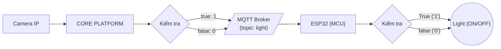
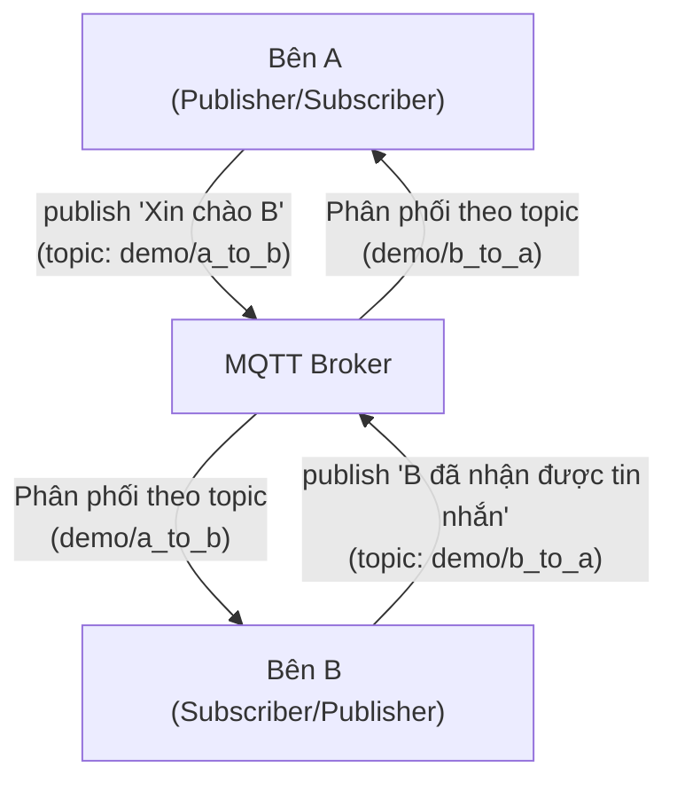

# Mô hình Giao tiếp Tin nhắn qua MQTT sử dụng Node-RED

Dự án minh họa nguyên lý giao tiếp **Publish/Subscribe** của giao thức **MQTT** và cách sử dụng **Node-RED** (`mqtt in`, `mqtt out`, `function`, `inject`, `debug`) để mô phỏng bên gửi, bên nhận, xử lý bản tin và kiểm chứng các tính năng lý thuyết của MQTT.

---

## 1. Kiến trúc & Nguyên lý giao tiếp

### 1.1. Sơ đồ hệ thống điều khiển (`CORE PLATFORM` $\rightarrow$ `MQTT` $\rightarrow$ `ESP32`)



### 1.2. Mô hình trao đổi hai chiều (`Bên A` $\leftrightarrow$ `Bên B`)



* **Broker:** Trạm trung gian tiếp nhận và phân phối tin nhắn tới các bên đăng ký.
* **Topic:** Chủ đề dùng để định tuyến tin nhắn (ví dụ: `light`, `demo/a_to_b`, `demo/b_to_a`).
* **Payload:** Nội dung dữ liệu của tin nhắn (ví dụ: `"1"`, `"0"`, `"Xin chào B"`, hoặc chuỗi JSON).

---

## 2. Cấu trúc thư mục Project

```text
mqtt-nodered-project/
├── nodered/
│   └── flows.json              # File cấu hình Flow để Import trực tiếp vào Node-RED
├── src/
│   ├── node_red_functions.js   # Toàn bộ code xử lý bên trong các node Function của Node-RED
│   ├── publisher_core.js       # Code Node.js minh họa bên gửi (CORE PLATFORM)
│   └── subscriber_esp32.js     # Code Node.js minh họa bên nhận (ESP32 MCU)
├── package.json
└── README.md
```

---

## 3. Đối chiếu giữa Logic Code và Node-RED

| Logic trong chương trình | Cách thể hiện trong Node-RED |
| :--- | :--- |
| Cấu hình và kết nối Broker | Cấu hình **Server** (`localhost:1883` hoặc `broker.emqx.io:1883`) trong node MQTT |
| Tạo sự kiện gửi | Node `inject` |
| Chuẩn bị `topic`, `payload` và rẽ nhánh logic | Node `function` |
| Publish thông điệp lên Broker | Node `mqtt out` |
| Subscribe và tiếp nhận thông điệp | Node `mqtt in` |
| Xử lý thông điệp nhận & Quan sát kết quả | Node `function` + Node `debug` |

---

## 4. Giải thích Code trong Node-RED

### 4.1. Mô hình `CORE PLATFORM` $\rightarrow$ `ESP32 (Light)` (Tab 1)

* **Code tại node `function` của `CORE PLATFORM` (Bên gửi):**
  ```javascript
  const isDetected = msg.payload; // Tín hiệu từ Camera IP (true/false)
  msg.topic = "light";

  if (isDetected === true) {
      msg.payload = "1"; // Nhánh true:1
  } else {
      msg.payload = "0"; // Nhánh false:0
  }
  return msg;
  ```

* **Code tại node `function` của `ESP32 (MCU)` (Bên nhận):**
  ```javascript
  const receivedTopic = msg.topic;
  const receivedPayload = String(msg.payload).trim();

  if (receivedPayload === "1" || receivedPayload.toLowerCase() === "true") {
      msg.lightState = "ON";
      msg.payload = `[ESP32 - topic '${receivedTopic}'] Nhận '${receivedPayload}' (True) -> LIGHT: BẬT (ON)`;
  } else {
      msg.lightState = "OFF";
      msg.payload = `[ESP32 - topic '${receivedTopic}'] Nhận '${receivedPayload}' (false) -> LIGHT: TẮT (OFF)`;
  }
  return msg;
  ```

### 4.2. Mô hình giao tiếp 2 chiều `Bên A` $\leftrightarrow$ `Bên B` (Tab 2)

* **Code tạo tin nhắn của A (`demo/a_to_b`):**
  ```javascript
  msg.topic = "demo/a_to_b";
  msg.payload = "Xin chào B";
  return msg;
  ```
* **Code tạo tin nhắn của B (`demo/b_to_a`):**
  ```javascript
  msg.topic = "demo/b_to_a";
  msg.payload = "B đã nhận được tin nhắn";
  return msg;
  ```
* **Code gửi dữ liệu dạng JSON (nhiều trường thông tin):**
  ```javascript
  msg.topic = "demo/a_to_b";
  msg.payload = JSON.stringify({
      sender: "A",
      text: "Xin chào B"
  });
  return msg;
  ```

---

## 5. Hướng dẫn cài đặt và chạy thử

### Cách 1: Chạy trực tiếp trên Node-RED
1. Khởi động Node-RED:
   ```bash
   npx node-red
   ```
2. Mở trình duyệt tại `http://localhost:1880`.
3. Nhấn `Ctrl + I` (Import) $\rightarrow$ chọn file `nodered/flows.json` trong repo này $\rightarrow$ nhấn **Import** $\rightarrow$ nhấn **Deploy**.
4. Bấm vào các nút ở đầu node `inject` và mở tab **Debug** (góc phải) để quan sát kết quả.

### Cách 2: Chạy thử bằng code Node.js thuần
```bash
npm install
# Mở Terminal 1 (Chạy bên nhận ESP32):
npm run start:esp32

# Mở Terminal 2 (Chạy bên gửi CORE PLATFORM):
npm run start:core
```

---

## 6. Kịch bản 5 bài Test lý thuyết trên Node-RED

1. **Test 1 (Topic quyết định bên nhận):** Giữ A gửi vào `demo/a_to_b`, đổi `mqtt in` của B thành `demo/other` $\rightarrow$ B không nhận được tin vì Topic không khớp.
2. **Test 2 (Một bên gửi, nhiều bên nhận):** Tạo thêm 1 node `mqtt in` cùng đăng ký `demo/a_to_b` $\rightarrow$ Khi A gửi, cả 2 nhánh đều nhận được tin nhắn cùng lúc.
3. **Test 3 (Wildcard `+` và `#`):** Đổi topic của node `mqtt in` thành `demo/#` $\rightarrow$ Nhận được tất cả tin nhắn từ cả `demo/a_to_b` và `demo/b_to_a`.
4. **Test 4 (Retained Message):** Bật tùy chọn **Retain** (`msg.retain = true`) trên `mqtt out` và gửi `"Trạng thái mới nhất: sẵn sàng"`. Khi một subscriber mới kết nối vào đúng topic sẽ nhận ngay thông điệp này mà không cần bên gửi gửi lại.
5. **Test 5 (Mức chất lượng dịch vụ QoS 0, 1, 2):** Thay đổi QoS trên node MQTT (`QoS 0`: tối đa 1 lần, `QoS 1`: ít nhất 1 lần, `QoS 2`: đúng 1 lần) và quan sát thuộc tính `msg.qos` trong cửa sổ Debug.
