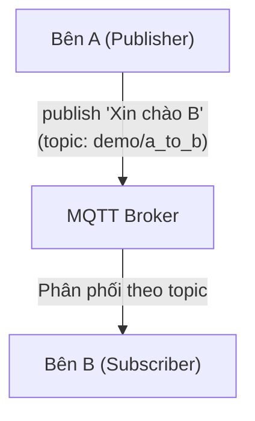

# Mô hình Gửi–Nhận Tin nhắn qua MQTT với Node-RED

Bài thực hành minh họa giao tiếp tin nhắn theo mô hình **Publish/Subscribe** của giao thức **MQTT**, sử dụng **Node-RED** để tạo bên gửi, bên nhận, xử lý thông điệp và kiểm nghiệm các tính năng lý thuyết (Topic, Wildcard, QoS, Retained Message).

---

## 1. Nguyên lý giao tiếp MQTT

Trong MQTT, bên gửi (**Publisher**) không gửi trực tiếp đến địa chỉ của bên nhận (**Subscriber**), mà gửi thông điệp vào một chủ đề (**Topic**) trên **Broker**. Broker tiếp nhận và phân phối thông điệp tới tất cả các bên đã đăng ký (subscribe) chủ đề tương ứng.



**Ba thành phần cốt lõi:**
* **Broker:** Trạm trung gian tiếp nhận và phân phối tin nhắn.
* **Topic:** Chủ đề dùng để định tuyến tin nhắn.
* **Payload:** Nội dung dữ liệu của tin nhắn.

**Quy ước topic minh họa giao tiếp hai chiều:**

| Chiều giao tiếp | Topic | Payload ví dụ |
| :--- | :--- | :--- |
| **A gửi B** | `demo/a_to_b` | `Xin chào B` |
| **B gửi A** | `demo/b_to_a` | `B đã nhận được tin nhắn` |

---

## 2. Đối chiếu giữa Code giao tiếp và Node-RED

Ở mức lý thuyết, cấu trúc một chương trình giao tiếp MQTT gồm các bước:

```text
Khởi tạo MQTT client
Cấu hình địa chỉ broker và thông tin kết nối

Khi kết nối thành công:
    Đăng ký (subscribe) topic cần nhận

Khi cần gửi:
    Chọn topic
    Tạo nội dung tin nhắn (payload)
    Publish tin nhắn lên broker

Khi nhận tin nhắn:
    Đọc topic
    Đọc payload
    Hiển thị hoặc xử lý nội dung
```

Trong **Node-RED**, các bước trên được ánh xạ trực tiếp sang từng node:

| Logic trong chương trình | Cách thể hiện trong Node-RED |
| :--- | :--- |
| Cấu hình và kết nối Broker | Cấu hình **Server** (`localhost:1883`) của node MQTT |
| Tạo sự kiện gửi | Node `inject` |
| Chuẩn bị `topic` và `payload` | Node `function` (hoặc cấu hình trực tiếp trên `inject`) |
| Publish thông điệp | Node `mqtt out` |
| Subscribe và tiếp nhận thông điệp | Node `mqtt in` |
| Quan sát kết quả | Node `debug` |

---

## 3. Mô hình Test hai chiều trên Node-RED

Trên cùng một workspace của Node-RED, hai vai trò **Bên A** và **Bên B** được thiết kế như sau:

```text
BÊN A
[inject] -> [function: tạo tin A] -> [mqtt out: demo/a_to_b]
[mqtt in: demo/b_to_a] -> [debug: A nhận]

BÊN B
[mqtt in: demo/a_to_b] -> [debug: B nhận]
[inject] -> [function: tạo tin B] -> [mqtt out: demo/b_to_a]
```

### 3.1. Code tạo tin nhắn của Bên A
Trong node `function: tạo tin A`:
```javascript
msg.topic = "demo/a_to_b";
msg.payload = "Xin chào B";
return msg;
```
* `msg.topic`: xác định chủ đề gửi.
* `msg.payload`: chứa nội dung tin nhắn.
* `return msg`: chuyển đối tượng thông điệp đến node `mqtt out` tiếp theo trong flow (trường Topic trên node `mqtt out` được để trống để tự động lấy từ `msg.topic`).

### 3.2. Code tạo tin nhắn của Bên B
Trong node `function: tạo tin B`:
```javascript
msg.topic = "demo/b_to_a";
msg.payload = "B đã nhận được tin nhắn";
return msg;
```

---

## 4. Phân biệt đối tượng `msg` trong Flow và tin nhắn MQTT

Trong Node-RED, `msg` là đối tượng JavaScript được truyền qua các node trong flow. Khi đi vào node `mqtt out`, chỉ có `msg.topic` được dùng làm chủ đề xuất bản và `msg.payload` được gửi đi làm nội dung gói tin MQTT (toàn bộ các thuộc tính nội bộ khác của `msg` không tự động truyền qua MQTT).

Nếu muốn gửi nhiều trường dữ liệu cùng lúc, bên gửi chủ động đóng gói thành chuỗi **JSON**:

```javascript
msg.topic = "demo/a_to_b";

msg.payload = JSON.stringify({
    sender: "A",
    text: "Xin chào B"
});

return msg;
```
Ở phía nhận (`mqtt in`), chọn định dạng đầu ra là JSON (hoặc `auto-detect`) để chuyển chuỗi JSON ngược lại thành đối tượng và truy cập `msg.payload.sender`, `msg.payload.text`.

---

## 5. Các tính năng thực nghiệm và Ý nghĩa lý thuyết

| Bài Test | Cấu hình thử nghiệm trên Node-RED | Kết quả & Ý nghĩa lý thuyết |
| :--- | :--- | :--- |
| **Test 1: Topic quyết định bên nhận** | Giữ A gửi đến `demo/a_to_b`, đổi topic đăng ký của B thành `demo/other`. | B không nhận được tin của A vì topic không khớp. Chứng minh Broker định tuyến thông điệp hoàn toàn dựa trên sự trùng khớp giữa topic gửi và bộ lọc đăng ký của subscriber. |
| **Test 2: Một bên gửi, nhiều bên nhận** | Thêm một node `mqtt in` thứ hai cùng đăng ký `demo/a_to_b` và nối vào `debug`. | Khi A gửi tin, cả hai nhánh nhận đều nhận được cùng nội dung. Chứng minh MQTT hỗ trợ phân phối thông điệp một–nhiều (broadcast/multicast theo topic). |
| **Test 3: Đăng ký nhiều topic bằng Wildcard** | Đổi topic của một node `mqtt in` thành `demo/#`. | Node này nhận được cả tin từ `demo/a_to_b` lẫn `demo/b_to_a`. Ký hiệu `+` đại diện cho 1 cấp topic và `#` đại diện cho nhiều cấp topic trong bộ lọc đăng ký. |
| **Test 4: Retained Message** | Bật tùy chọn **Retain** (`msg.retain = true`) trên `mqtt out`, gửi `"Trạng thái mới nhất: sẵn sàng"`, sau đó cho một subscriber mới đăng ký đúng topic. | Subscriber mới nhận ngay thông điệp mà không cần bên gửi gửi lại. Broker lưu lại thông điệp retained gần nhất của topic (không phải lịch sử toàn bộ cuộc trò chuyện). |
| **Test 5: Quality of Service (QoS)** | Thay đổi cấu hình QoS của các node qua 3 mức: `0`, `1`, `2`. | **QoS 0:** Tối đa 1 lần (có thể mất tin, không xác nhận).<br>**QoS 1:** Ít nhất 1 lần (có xác nhận, có thể trùng).<br>**QoS 2:** Đúng 1 lần trên chặng MQTT.<br>*(Trong mạng local bình thường, kết quả trên Debug giống nhau vì chưa có hiện tượng rớt mạng).* |

---

## 6. Kết quả chạy thử trên Node-RED

*(Lưu ảnh chụp màn hình vào thư mục `images/` và hiển thị tại đây)*

* **Sơ đồ Flow và giao tiếp 2 chiều A $\leftrightarrow$ B:**
  ``
* **Kết quả Test 1 – Test 5 trên cửa sổ Debug:**
  ``
